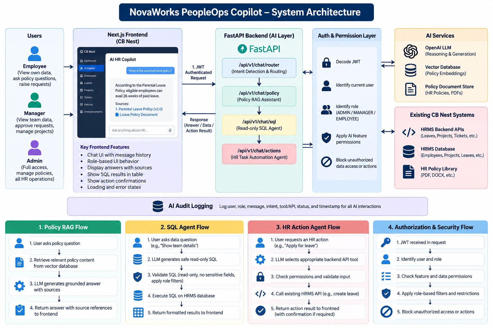
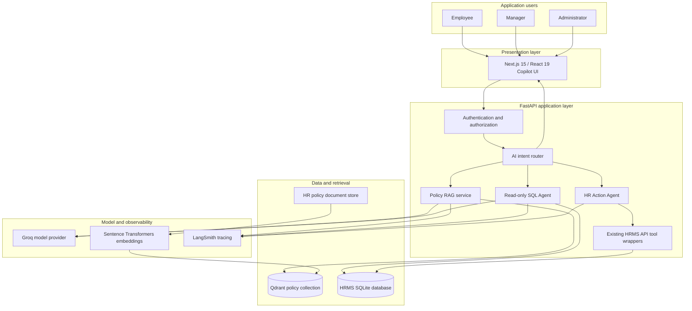
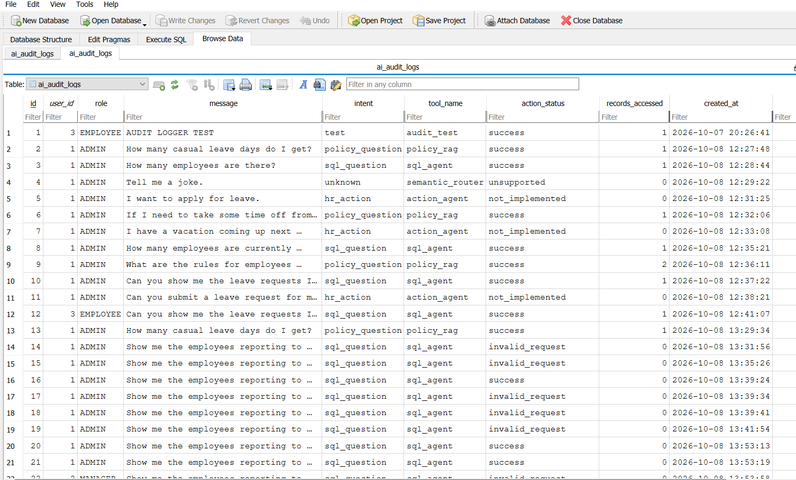
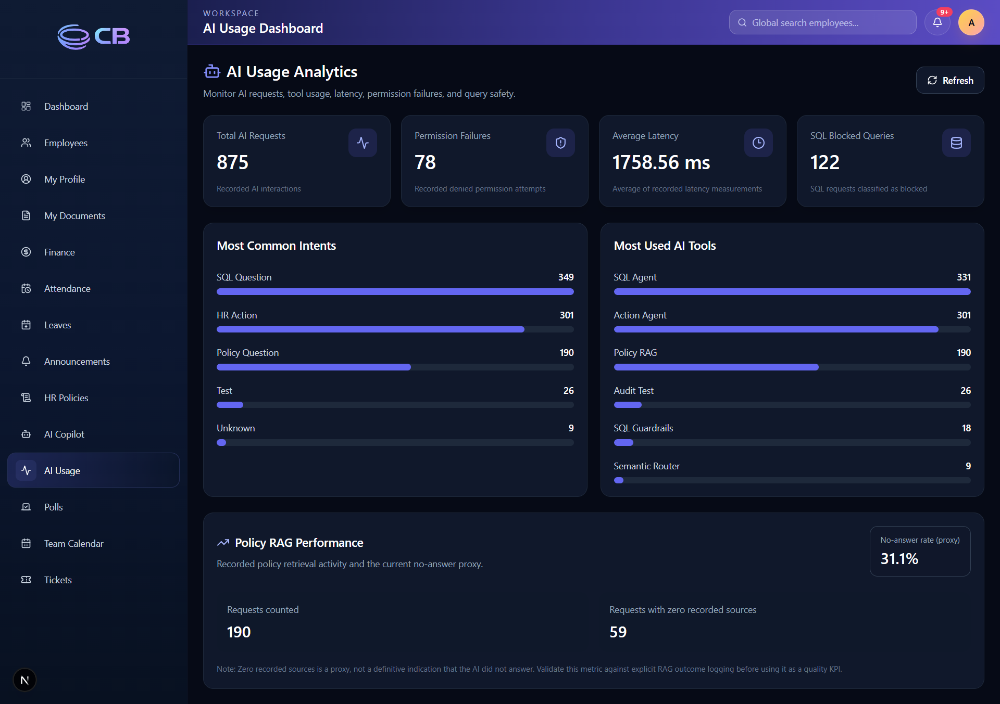

# NovaWorks PeopleOps Copilot
## Solution Architecture & Technical Design



## 1. Solution Overview

The NovaWorks PeopleOps Copilot is an AI capability integrated into the CB Nest Human Resource Management System. It provides a conversational interface to three distinct capabilities:

- **Policy intelligence:** retrieval-grounded answers from the HR policy library.
- **HR data intelligence:** read-only natural-language queries over permitted HR data.
- **Workflow automation:** supported HR operations executed through existing backend API tools.

The Copilot extends the existing HRMS application and authorization model. It does not replace the HRMS as the system of record, nor does it use generated SQL to perform business mutations.

## 2. Architecture at a Glance



The supplied system architecture image is retained above as the high-level visual. The Mermaid view provides a concise component and data-flow representation.

## 3. Technology Stack

| Layer | Technology | Role |
|---|---|---|
| Web application | Next.js 15, React 19, Tailwind CSS | Authenticated HRMS and Copilot experience |
| API layer | FastAPI | Chat routing, AI endpoints and integration with HRMS services |
| Data access | SQLAlchemy async, Pydantic v2 | Typed request handling and database access |
| Operational database | SQLite | Existing HRMS business records |
| Schema management | Alembic | Database migrations |
| Language model provider | Groq by default; OpenAI supported | Provider selected by `LLM_PROVIDER` |
| Groq model default | `llama-3.3-70b-versatile` | Overridable with `GROQ_MODEL` |
| OpenAI model default | `gpt-4o-mini` | Overridable with `OPENAI_MODEL` |
| Trace evidence | Supplied LangSmith screenshot shows `openai/gpt-oss-120b` metadata | Trace-time metadata is distinct from source-code defaults |
| Dense embeddings | `sentence-transformers/all-MiniLM-L6-v2` | Semantic policy retrieval |
| Sparse retrieval | `Qdrant/bm25` | Keyword-oriented retrieval signal |
| Vector database | Qdrant | Policy chunk and retrieval storage |
| Observability | LangSmith | Representative model and chain execution traces |

The provider/model identification is based on the supplied LangSmith trace metadata. Embedding and Qdrant settings reflect the implementation configuration recorded during development. Confirm active deployment settings from the environment and service configuration when deploying to another environment.

## 4. Request Processing

1. An authenticated user submits a request through the Copilot interface.
2. The frontend sends the request to the FastAPI application.
3. The backend resolves the authenticated user context and classifies the request intent.
4. The request is routed to the relevant capability:
   - Policy RAG
   - Read-only SQL Agent
   - HR Action Agent
5. The selected capability executes within the permissions and data scope applicable to the authenticated user.
6. The backend returns the result to the frontend in the response format defined by the endpoint schema.
7. Configured tracing and audit mechanisms capture execution metadata.

## 5. Capability Design

### 5.1 Policy RAG

Policy RAG answers HR policy questions using retrieved policy content rather than relying only on model knowledge.

**Processing sequence**

1. Receive the user's policy question.
2. Create the query representation required by the retrieval pipeline.
3. Retrieve relevant policy chunks from the `hr_policy` Qdrant collection.
4. Construct the context supplied to the language model.
5. Generate an answer grounded in the retrieved content.
6. Return the answer with source information for display in the Copilot UI.

**Retrieval configuration**

| Setting | Configured value |
|---|---|
| Qdrant collection | `hr_policy` |
| Dense embedding model | `sentence-transformers/all-MiniLM-L6-v2` |
| Sparse retrieval model | `Qdrant/bm25` |

When the retrieved content does not support an answer, the expected behavior is to state that the available policy information is insufficient rather than invent a policy rule.

### 5.2 Read-only SQL Agent

The SQL Agent converts supported natural-language HR data questions into database queries.

**Processing sequence**

1. Receive a natural-language data question.
2. Generate a candidate query for the supported data request.
3. Parse and validate the query before execution.
4. Reject unsafe, destructive, write, or otherwise disallowed SQL.
5. Apply the applicable role and record-access restrictions.
6. Execute the permitted query and return formatted results.

The SQL Agent is a read-only data access capability. It is not used to create, update, approve, assign, or delete HR business records.

### 5.3 HR Action Agent

The HR Action Agent performs supported HR workflows through existing backend API tools.

**Processing sequence**

1. Receive the user's requested HR operation.
2. Identify the supported action and required parameters.
3. Validate the request and the authenticated user's permissions.
4. Request confirmation where the action workflow requires it.
5. Invoke the existing HRMS API through its tool wrapper.
6. Return the operation result or a controlled error to the Copilot UI.

The HRMS backend remains responsible for business validation and persistence. The Action Agent must not bypass the API layer with direct business-table writes.

## 6. API Surface

The AI interaction endpoints documented for the Copilot are:

| Method | Endpoint | Responsibility |
|---|---|---|
| `POST` | `/api/v1/chat/router` | Unified intent routing for Copilot requests |
| `POST` | `/api/v1/chat/router/stream` | Streaming Copilot response |
| `POST` | `/api/v1/chat/actions` | HR Action Agent request handling |

The authoritative request and response contracts are the active FastAPI route handlers and Pydantic schemas in `backend/app/api/v1/endpoints/chat.py` and the associated schema/service modules. This document intentionally does not reproduce unverified payload fields.

The repository also contains chat-session/message JSON reference files. Those files are separate contract artifacts and must not be treated as the schema for the three AI endpoints above.

## 7. Identity, Permissions & Data Boundaries

- The backend derives the user identity and role from the authenticated application context.
- A role or employee identifier written in the natural-language prompt does not grant additional access.
- Employee self-service requests are restricted to the authenticated employee's permitted records.
- Manager operations are subject to the manager's authorized team and workflow scope.
- Administrator access remains subject to the existing HRMS authorization and sensitive-data rules.
- The SQL Agent is restricted to read-only operations and must reject destructive statements.
- The Action Agent uses existing HRMS API tools for supported mutations.
- Sensitive information—including credentials, bank details, PAN details and unauthorized payroll data—must not be disclosed.

The detailed role policy and evidence status are maintained in [`ai_permissions_matrix.md`](ai_permissions_matrix.md).

## 8. Environment Configuration

Create `backend/.env` from `backend/.env.example`. The implementation documentation identifies the following settings:

| Variable | Purpose |
|---|---|
| `DATABASE_URL` | SQLAlchemy database connection |
| `APP_TIMEZONE` | Application timezone |
| `JWT_SECRET_KEY` | JWT signing secret |
| `GROQ_API_KEY` | Credential for Groq inference |
| `QDRANT_PATH` | Local Qdrant persistence location |

Recorded local values include `sqlite+aiosqlite:///./storage/hrms.db`, `Asia/Kolkata`, and `backend/qdrant_storage`. Do not place secret values in source control or documentation. The checked-in `backend/.env.example` and active service configuration are authoritative for any additional settings.

## 9. Local Development

### Backend

From the `backend/` directory:

```powershell
uv pip install -r requirements.txt
uv run alembic upgrade head
uv run python scripts/seed.py
uv run uvicorn app.main:app --reload
```

Backend dependencies are managed through `backend/requirements.txt`. After changing dependencies, update that file and install with `uv pip install -r requirements.txt`.

### Frontend

From the `frontend/` directory:

```bash
npm install
npm run dev
```

Configure the frontend API base URL using the variable documented by the frontend environment example/configuration.

### Docker Compose

From the repository root:

```powershell
Copy-Item backend/.env.example backend/.env
docker-compose up -d --build
docker-compose exec api alembic -c alembic.ini upgrade head
docker-compose exec api python scripts/seed.py
```

The application is available at `http://localhost:3000`; FastAPI's interactive API documentation is available at `http://localhost:8000/docs`.

## 10. AI Usage Analytics & Persistent Audit Logging

### 10.1 Persistent audit records

Application-level AI audit events are persisted in the `ai_audit_logs` table. The inspected database table exposes the following columns:

| Column | Recorded information |
|---|---|
| `id` | Audit row identifier |
| `user_id` | Associated application user |
| `role` | User role |
| `message` | Request/message |
| `intent` | Classified intent |
| `tool_name` | Selected AI tool or service |
| `action_status` | Outcome/status |
| `records_accessed` | Number of records reported as accessed |
| `created_at` | Timestamp |

The inspected table contains persisted entries across policy RAG, SQL Agent, Action Agent, semantic routing, and audit-test activity. Observed statuses include `success`, `unsupported`, `not_implemented`, and `invalid_request`. This demonstrates that the application audit table contains both successful and non-successful interaction records.



### 10.2 AI Usage Dashboard

The administrator-facing AI Usage Dashboard is available at `/ai-usage`. Its analytics API is:

`GET /api/v1/ai-usage/analytics`

The supplied dashboard capture displays these measures:

- Total AI requests
- Permission failures
- Average latency
- SQL blocked-query count
- Most common intents
- Most-used AI tools
- Policy RAG request count and zero-source proxy

The captured dashboard showed 875 total AI requests, 78 permission failures, 1,758.56 ms average latency, and 122 SQL blocked queries at the time of capture. These are screenshot-time values, not permanent system constants.

The Policy RAG panel labels its zero-source measure as a proxy and explicitly cautions that it is not a definitive indicator that the AI did not answer. It should not be presented as a standalone RAG quality score.



### 10.3 Audit logging and tracing are separate

- **Application audit logging:** persists request-level interaction and outcome metadata in `ai_audit_logs`.
- **LangSmith tracing:** provides model/chain execution visibility for selected runs.

These mechanisms serve different purposes. LangSmith traces do not replace the persistent application audit table, and the audit table does not by itself provide the full model execution trace.

## 11. Persistent Application State: Audit, HITL & Cache

### 11.1 AI audit log

The SQLAlchemy model is `AIAuditLog` in `backend/app/models/ai_audit_log.py`; its table is `ai_audit_logs`.

| Column | Type / role |
|---|---|
| `id` | Integer primary key |
| `user_id` | Foreign key to `employees.id` |
| `role` | Role string |
| `message` | Text after audit-message redaction |
| `intent` | Classified intent |
| `tool_name` | Selected tool/service |
| `action_status` | Recorded outcome |
| `records_accessed` | Integer count, default 0 |
| `latency_ms` | Optional floating-point latency |
| `created_at` | Timestamp with database default |

**Migrations**
- `0017_ai_audit_logs.py` creates the audit table and indexes.
- `bdfc4f3d0ad9_add_ai_audit_latency.py` adds `latency_ms`.

**Write path:** `backend/app/services/ai/audit_logger.py` implements `log_ai_interaction`. The chat endpoint calls it for the direct SQL, policy and action handlers, the unified router paths, and the policy streaming path. The logger redacts common email, PAN, labelled credential, bank-account and Aadhaar-like patterns. It uses a separate `SessionLocal` session, retries transient SQLite lock errors up to three attempts, and is best-effort so audit persistence errors do not intentionally break the Copilot request.

### 11.2 AI Usage Dashboard and analytics

The frontend page is `frontend/app/ai-usage/page.tsx`; the route is `/ai-usage`. The sidebar entry is marked `adminOnly` in `frontend/components/layout/sidebar.tsx`.

The frontend calls `GET /api/v1/ai-usage/analytics` through `fetchAIUsageAnalytics` in `frontend/lib/api.ts`. The FastAPI handler in `backend/app/api/v1/endpoints/ai_usage.py` independently applies `Depends(require_roles(Role.ADMIN))`.

The endpoint aggregates:
- Total audit rows
- Counts by intent and tool
- `permission_denied` outcomes
- Average non-negative recorded latency
- SQL rows whose status is in the blocked-status set
- Policy RAG rows with zero `records_accessed`

**Metric interpretation:** `rag_no_answer_rate` is calculated from policy RAG rows with zero recorded sources. It is explicitly a proxy, not a definitive answer-quality or no-answer metric. The screenshot's dashboard values are time-specific sample values and can change as audit rows accumulate.

### 11.3 Human-in-the-loop confirmation records

`PendingActionConfirmation` is defined in `backend/app/models/hitl_confirmation.py`; the table is `pending_action_confirmations`, created by migration `0018_pending_action_confirmations.py`.

The record contains a unique token, user ID, action type, original question, status, created/expiry times, confirmation/completion times and optional error message. `hitl_service.py` defines a 10-minute confirmation TTL, user-bound lookup, atomic claim of a pending confirmation, cancellation and completion/failure status updates.

### 11.4 Policy semantic cache

`backend/app/services/ai/semantic_cache.py` implements a separate SQLite cache at `backend/storage/hr_policy_semantic_cache.sqlite3`. It creates the `policy_semantic_cache` table and its indexes directly using SQLite; no SQLAlchemy model or Alembic migration for this cache table is present in the reviewed source.

The cache stores the question, embedding, answer, source references, timestamp, version, topic and intent. Defaults:
- TTL: 24 hours (`HR_POLICY_CACHE_TTL_SECONDS`)
- Similarity threshold: `0.68` (`HR_POLICY_CACHE_THRESHOLD`)
- Cache version: `2` (`HR_POLICY_CACHE_VERSION`)

Semantic matches require compatible known topic and intent labels. Exact normalized-question matching is supported. Only answers with non-empty source references are cached. Cache failures are swallowed so caching remains an optimization rather than a dependency for Policy RAG.

## 12. Observability

LangSmith is used to inspect representative LLM and chain execution traces. The supplied evidence includes policy-generation and SQL-agent traces, including provider/model metadata and token usage where visible.

Trace screenshots demonstrate selected execution paths. They do not establish exhaustive instrumentation of every endpoint, tool call, permission failure, latency measurement, token count, or error path. Trace configuration should continue to protect personal and confidential HR data.

## 13. Security Controls

| Control | Design decision |
|---|---|
| Authentication | Reuse the existing authenticated HRMS identity |
| Authorization | Enforce permissions in backend services and API operations |
| Record scope | Apply employee ownership and manager team boundaries |
| SQL execution | Validate and restrict the SQL Agent to read-only operations |
| Business mutations | Route through existing HRMS APIs |
| Sensitive data | Deny unauthorized access to credentials, bank, PAN and payroll data |
| Prompt injection | Do not allow user prompts to override system or authorization controls |
| Secrets | Store credentials in environment configuration; exclude `.env` from source control |
| Observability | Avoid unnecessary sensitive payloads in traces and logs |

## 14. Known Operational Limitations

- Ambiguous natural-language requests can be misclassified by intent routing; routing rules and regression tests need to evolve with supported use cases.
- SQL requests that cannot be safely parsed are rejected rather than executed.
- The Action Agent supports only operations implemented by its available API tool wrappers.
- Some operations require explicit identifiers or additional parameters.
- Token streaming has been exercised. Rich intermediate agent-step status presentation is not treated as fully verified in the supplied evaluation evidence.
- The LangSmith screenshots are representative examples, not evidence of complete trace coverage.
- A previously observed employee leave-balance request routing issue was recorded during testing. It should be considered unresolved unless a later successful retest is available.

### Database session and migration metadata

The asynchronous SQLAlchemy engine and session factory are defined in `backend/app/db/session.py`. The `get_db()` dependency yields an `AsyncSession` from `SessionLocal`. The declarative metadata base is defined in `backend/app/db/base.py`.

Alembic configuration is in `backend/alembic/env.py`. It reads `DATABASE_URL`, converts the async SQLite URL to a synchronous URL for Alembic's engine, and assigns `Base.metadata` as `target_metadata`.

The supplied Alembic environment imports the standard HRMS model modules. The supplied `backend/app/models/__init__.py` does not visibly export `AIAuditLog` or `PendingActionConfirmation`. Their existing tables are created by explicit versioned migrations (`0017_ai_audit_logs.py` and `0018_pending_action_confirmations.py`). For future Alembic autogeneration of changes to these AI models, ensure both modules are imported before `target_metadata` is evaluated.

## 15. Operational Maintenance

- Keep backend dependencies in `backend/requirements.txt`.
- Apply Alembic migrations before seeding a new local database.
- Preserve existing HRMS workflows when modifying AI services or endpoints.
- Update the endpoint contract documentation when route schemas change.
- Add regression tests for new routing patterns, tools and authorization paths.
- Record a test as passed only when supported by test output, an API result, or a corresponding screenshot.

